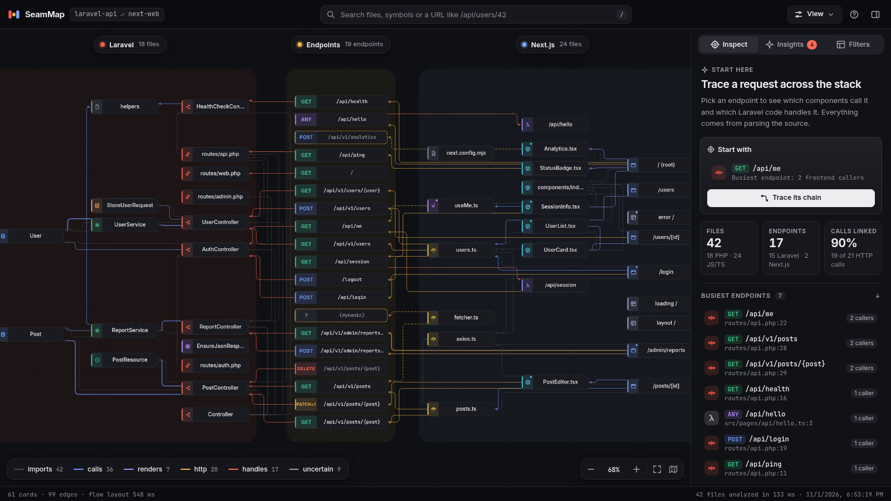
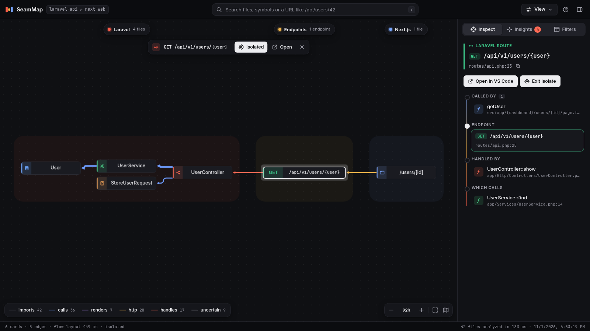
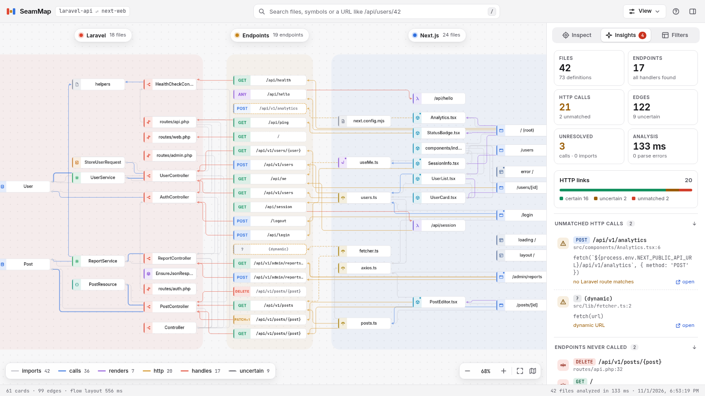
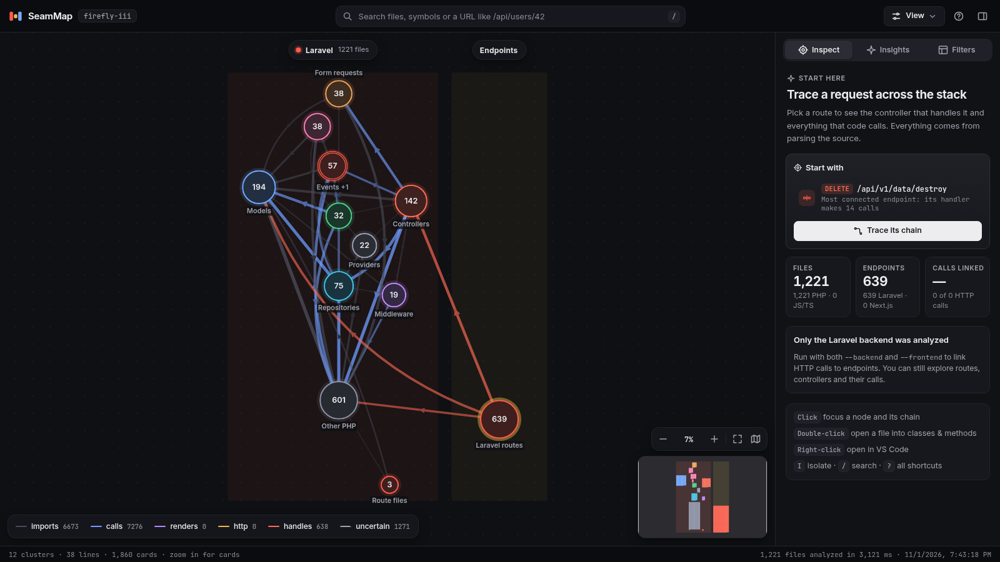
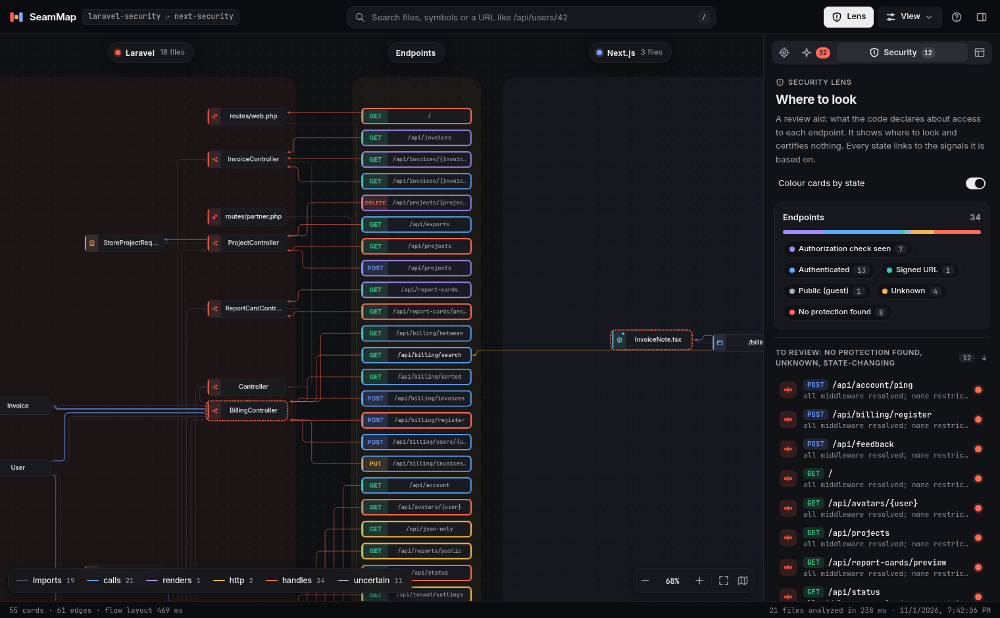
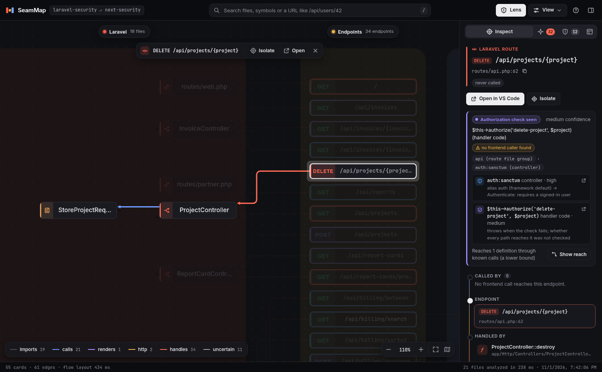
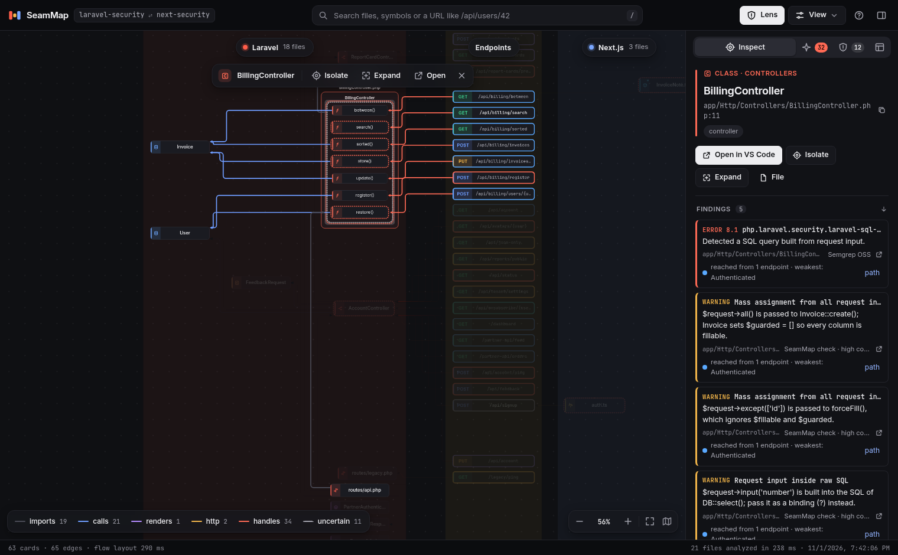

# SeamMap

SeamMap is a deterministic codebase visualizer for a **Laravel (PHP) backend** and a **Next.js (TypeScript/JavaScript) frontend**. It parses both projects with Tree-sitter, links frontend HTTP calls to Laravel routes by URL matching, and renders one interactive graph: **Laravel on the left, API endpoints in the middle, Next.js on the right**.

The question it answers is *"which component calls which endpoint, which controller handles it, and what does that controller call next?"*. It uses no AI, no network services and no code from the analyzed projects. Everything comes from parsing source files, so the same input always gives the same `graph.json`.



*Selecting an endpoint and pressing **Isolate** lays out just its chain. The panel shows the request flow: page → `GET /api/v1/users/{user}` → `UserController::show()` → `UserService::find`.*



*Light theme, with the Insights tab: link coverage, unmatched calls and endpoints nobody calls.*



*A real Laravel app (Firefly III, 1,221 PHP files and 639 routes) in grouped mode:*



---

## Quick start

```bash
cd my-project              # a Laravel app, a Next.js app, or a monorepo with both
npx seammap .              # analyze, write .seammap/graph.json, open the viewer
npx seammap . --security   # add the security lens
```

Or name the two projects: `npx seammap --backend ./api --frontend ./web`. The command analyzes the code, prints a summary with per-stage timings, serves the viewer on <http://localhost:5178/> and opens your browser. It never runs your projects, and nothing leaves your machine.

> **Name.** `seammap` is a placeholder: the name is taken on npm and crowded on the VS Code Marketplace, and the package is marked `private` until a final name is chosen (see [docs/PUBLISHING.md](docs/PUBLISHING.md)). Until it is published, run it from a clone (see *From source* below).

## Installation

* **Node.js 20 or newer.** Nothing else: no compiler, no Python, no build step.
* **Try it** with `npx seammap ...`, **install it globally** with `npm install -g seammap` (or `pnpm add -g seammap`), or add it to a project with `npm install -D seammap` and run `npx seammap`.
* **Platforms.** The package carries prebuilt Tree-sitter parsers for Linux, macOS and Windows, each on x64 and arm64. On Linux they need glibc 2.17 or newer, which is older than what Node 20 itself needs, so they run wherever Node does (Debian 12 and Ubuntu 22.04 included). Alpine Linux (musl) is supported on x64: the core parser ships a musl build, the grammar parsers load there as built, and CI runs `node:22-alpine`. Alpine on arm64 is not supported. Other platforms (32-bit ARM, FreeBSD...) get a clear error.
* **Clean installs.** The published package has no native dependencies, no install scripts and no peer-dependency ranges, so npm and pnpm install it without warnings and without running anything. Download size is about 5.8 MB (39 MB unpacked, mostly the parsers for six platforms).
* **Offline and private.** The analysis reads files and writes `graph.json`; the viewer is served from your machine on `localhost`, with Cytoscape, ELK and the fonts bundled. No telemetry, no update checks, no requests to any server.

### From source

```bash
git clone <repo> && cd <repo>
npm install          # the repo's .npmrc sets legacy-peer-deps for the Tree-sitter grammar packages (dev only)
npm run build        # TypeScript to dist/, query files, and the prebuilt parsers into dist/native
node dist/cli.js --backend fixtures/laravel-api --frontend fixtures/next-web
```

`npm run build` copies the parsers' prebuilt binaries from the dev-only Tree-sitter packages into `dist/native` (`scripts/vendor-native.mjs`): the published package ships those binaries and depends on none of the Tree-sitter packages, which is what keeps installs clean. A few upstream binaries are replaced by the rebuilds in `native-prebuilds/`: the core binding on every platform (upstream's crash in Node 20, and on Linux need GCC 13's libstdc++) and the TypeScript grammar on Linux arm64 (upstream's is an x86-64 binary). `native-prebuilds/README.md` explains, and the native-prebuilds workflow rebuilds them. `npm link` gives a global `seammap` command from the clone.

Parsing stack: `tree-sitter@0.25.1`, `tree-sitter-php@0.24.2` (its `php` export, which accepts the `<?php` tag and inline HTML; `php_only` is for tag-less PHP), `tree-sitter-typescript@0.23.2` (`typescript` for `.ts`, `tsx` for `.tsx`/`.jsx`) and `tree-sitter-javascript@0.25.0` (`.js`/`.mjs`/`.cjs`).

### Programmatic API

The command line is the main way to use the tool. For scripts and integrations, the analysis itself is available:

```js
import { analyze, loadConfig, resolveRoots } from 'seammap';

const { graph } = analyze({ backend: '/path/to/api', frontend: '/path/to/web', security: true });
console.log(graph.meta.stats, graph.security?.summary);
```

`analyze()` takes `backend` and `frontend` roots (either may be `null`), an optional `config` (the shape of `seammap.config.json`; `findConfig(starts)` picks the file the CLI would use, `loadConfig(file, cwd)` reads one, defaults otherwise) and `security`, and returns `{ graph }`: exactly what the CLI writes to `graph.json`, with TypeScript types for every field. `resolveRoots()` and `findProjects()` expose the CLI's project detection, and `checkSchema(graph)` tells whether this version can read a `graph.json` (`SCHEMA_VERSION` is the format version it writes). The package is ESM; Node 20.19+ and 22.12+ can also `require()` it. These exports, the `graph.json` format, the command line and the config file are the public surface (see [Versioning](#versioning)); everything else is internal.

### Editor extension (VS Code)

`extension/` is the same analyzer and the same viewer as a VS Code extension: **SeamMap: Open Map** analyzes the workspace in a background process (with progress and cancel) and opens the map in an editor tab; clicking through opens files at the right line beside it; the active editor's file is highlighted on the map; the status bar says when files changed since the analysis. Settings (`seammap.backend`, `seammap.frontend`, `seammap.configFile`, `seammap.security`) act like the CLI's options, and the config file is found by the same rule. It is one universal package for every platform, works over remote development (WSL, SSH, containers), supports Restricted Mode, and makes no network requests. See [`extension/README.md`](extension/README.md).

```bash
npm ci && npm run build                     # the analyzer, in dist/
cd extension && npm ci && npm run build     # the extension, in extension/out/
npm test                                    # integration tests in a downloaded VS Code (CODE_EXECUTABLE=... for a local one)
npm run package                             # dist-extension/seammap-<version>.vsix; install it with code --install-extension
```

## Usage

```
seammap --backend <laravelPath> --frontend <nextPath> [options]
seammap <monorepoRoot> [options]

  -b, --backend <path>   Laravel project root
  -f, --frontend <path>  Next.js project root
  -c, --config <file>    config file (default: the nearest seammap.config.json in or above the projects)
  -o, --out <dir>        output directory for graph.json (default: .seammap)
  -p, --port <n>         viewer port (default: 5178; the next free port is used if busy)
      --no-open          do not open the browser
      --json-only        write graph.json and exit without serving
      --list             print every definition and route with file:line, then exit
      --security         add the security lens: route protection signals for review (see below)
      --sarif <files...> import SARIF results from your own scanners (implies --security)
```

* **Output:** `<out>/graph.json`, by default `.seammap/graph.json` in the current directory.
* **Monorepo mode:** `seammap <root>` searches `<root>` and its subdirectories (3 levels deep, skipping `node_modules`, `vendor`, dot-directories and similar) for a Laravel project (`composer.json` + `artisan`) and a Next.js project (`package.json` with a `next` dependency). If it finds several candidates of one kind, or none at all, it stops and asks for `--backend` / `--frontend`.
* **One side only:** `--backend` alone or `--frontend` alone works; a warning says the other side is missing.
* **Robustness:** a missing path, failed detection or an unparseable config file gives a clear error and exit code 1. An unreadable or unparseable source file never stops the run: it is logged, counted in `parseErrors`, and analysis continues. A missing `composer.json` (default `App\ => app/`) or `tsconfig.json` (no path aliases) only produces a warning.
* **Exit codes:** `0` when the analysis ran (whatever it found, security findings included), `1` on any error: invalid arguments or config, no project found, a project path that doesn't exist, an output folder that can't be written. Problems inside a project (unreadable files and folders, SARIF files that can't be read) are warnings, not errors. With `--json-only` the command writes `graph.json`, prints the summary and exits, which makes it usable in scripts; a future CI mode can add codes of its own without changing these.

### Viewer controls

| Action | How |
| --- | --- |
| Focus a node (highlight neighbours, fade the rest) | click |
| Clear the focus, leave isolation | click the background, or `Esc` |
| Focus depth | **Focus** in the top bar: `Auto` (endpoints → whole chain, others → 1 hop), `1`, `2`, `Chain` |
| Show only the focused chain, laid out on its own | **Isolate**, or `I` (toggle) |
| Expand or collapse a file into its classes, functions and methods | double-click the file, `E`, or **Expand** in the panel |
| Open in VS Code (`vscode://file/<abs-path>:<line>`) | right-click any node, double-click a function/method/endpoint, `O`, or **Open in VS Code** in the panel |
| Search by name, path or URL | `/` focuses the search; a concrete URL such as `/api/v1/users/42` finds the matching route pattern; `↑ ↓ ↵` to pick |
| Zoom and navigate | scroll and drag; the zoom bar (`−` `+`, the % resets to 100%, fit); `+` `−` `F` keys; the minimap (drag to pan) |
| Jump to a column | click a lane header (Laravel / Endpoints / Next.js) |
| Show or hide edge kinds | the legend at the bottom left (it is also the toggle), or the **Filters** tab |
| Hide groups (roles, Next.js kinds) | **Filters** tab (per group, or all/none per lane) |
| Inspect an edge (each underlying call site, with links to its line) | click the edge |
| Layout | **Layout** in the top bar: `Auto` / `Flow` / `Grouped` (see [Viewer](#viewer)) |
| Theme, panel, help | `T` light/dark, `P` show/hide the panel, `?` shortcuts |
| Security lens outlines (graphs built with `--security`) | **Lens** in the top bar, or `S` |

The side panel has three tabs (four with `--security`):
* **Inspect.** With nothing selected it is a starting dashboard: key numbers, the busiest endpoints, and call-outs for problems. With a node selected it shows the node's details and actions. Endpoints get a **request flow** (callers → endpoint → handler → what the handler calls). Other nodes get grouped connection lists, and collapsed files list their contents.
* **Insights.** Stat tiles, link coverage (certain / uncertain / unmatched), unmatched HTTP calls with their source expressions, endpoints never called, unresolved references by reason, warnings, diagnostics, and per-stage timings.
* **Security** (only with `--security`). See [Security lens](#security-lens---security).
* **Filters.** Edge kinds and the per-group visibility switches.

## Configuration (`seammap.config.json`)

The config file is optional. Comments and trailing commas are allowed, and relative paths resolve against the config file's own directory. Command-line flags override `backend`/`frontend`. A value of the wrong type, or a file that isn't a JSON object, is an error that names the file and the key; an unknown key (a typo, or a setting of a newer version) is a warning with the closest known key. `include` patterns are relative to the project and can't reach outside it.

**Which file is used** does not depend on where you run the command:
1. `--config <file>`, when given.
2. Otherwise the nearest `seammap.config.json` to the projects: in the backend root and the frontend root (or the monorepo root you name, or the current folder when you name no project), then in the folders above them, up to the repository root (the folder with `.git`). Outside a git repository the search stops at the folder that holds all the named projects, so a lone project only checks its own folder.
3. When the backend and the frontend each lead to a different file, the one whose `backend`/`frontend` names the projects being analyzed wins, then the closer one, then the backend's. The others are listed as warnings.

The summary always says which file was used and why (for example `../seammap.config.json (1 folder above the backend root)`), or that none was found and where it looked. `graph.json` records it in `meta.config` (see below), so two runs with different results can be told apart.

```jsonc
{
  "backend": "../api",          // Laravel root
  "frontend": "../web",         // Next.js root
  "laravel": {
    "apiPrefix": "/api",        // prefix for routes/api.php (default: bootstrap/app.php apiPrefix, else /api)
    "controllerNamespace": "App\\Http\\Controllers", // for unqualified 'Controller@method' strings
    "include": ["modules/**/*.php"],                 // extra globs to scan
    "exclude": ["app/Legacy/**"]                     // globs to skip
  },
  "next": {
    "include": [],
    "exclude": ["src/stories/**"],
    "backendEnvVars": ["NEXT_PUBLIC_API_URL"],  // if set, ONLY these env vars mean "the Laravel backend"
    "baseUrlVariables": ["API_URL", "config.apiUrl"], // identifiers treated as the backend base URL
    "backendHosts": ["api.example.com"],        // absolute URLs on these hosts target Laravel (localhost always does)
    "backendBasePath": { "NEXT_PUBLIC_API_URL": "/api" } // path the base URL carries ("/api" for all, or per variable)
  },
  "security": {                                 // only used with --security; see "Security lens"
    "authMiddleware": ["tenant.auth"],          // treat as authentication
    "authorizationMiddleware": ["App\\Http\\Middleware\\EnsureAdmin"],
    "publicMiddleware": [],                     // treat like guest
    "ignoreMiddleware": ["App\\Http\\Middleware\\SetLocale"], // known not to restrict access
    "sarif": ["reports/semgrep.sarif"],         // scanner results to import (relative to this file)
    "checks": true,                             // SeamMap's local checks
    "disableChecks": []
  }
}
```

## How it works

```
scan ─► parse ─► extract ─► resolve ─► link ─► graph.json ─► viewer
fast-glob   Tree-sitter   queries + per-file   cross-file   URL matching   Cytoscape + ELK
+ ignore    (native)      traversal (lang/*)   (lang/*)     (match/*)
```

* **Adapters.** Each language has an adapter (`src/lang/php`, `src/lang/js`) that implements the same stages and emits nodes, edges, endpoints and HTTP calls. The pipeline (`src/analyze.ts`), graph builder, matcher and viewer are shared. Each stage is timed and the summary prints the timings.
* **Extraction.** Rules live in Tree-sitter query files: `src/lang/*/queries/*.scm` for declarations, call sites, JSX usages and local declarations. The native query engine finds the interesting nodes, and each capture is attributed to its enclosing method, function or route closure by byte range. Hand-written code handles what queries express poorly: name resolution, route chains, URL expressions.
* **Separation.** The analyzer never imports the viewer, so it can be tested without a UI (`analyze()` returns the graph). The viewer only reads `graph.json`.

## Detection and scanning rules

**Laravel.** Files scanned:
* the PSR-4 source roots from `composer.json` (normally `app/`)
* `routes/`
* composer `files` autoloads
* `laravel.include` globs

Always skipped: `vendor/`, `storage/`, `bootstrap/cache/`, `public/`, `node_modules/`, `database/`, `config/`, `tests/`, `resources/views/`, `routes/console.php`, `routes/channels.php`, plus `.gitignore`d files and `laravel.exclude`. `bootstrap/app.php` is only read to find route registrations. Route files are read wherever they are: the app's `routes/` and any module's or package's `Routes/` / `routes/` folder (`modules/Blog/Routes/web.php`), loaded by `bootstrap/app.php` or by any service provider that registers routes.

**Next.js.** Files scanned: `**/*.{js,jsx,ts,tsx,mjs,cjs}`. Always skipped: `node_modules`, `.next`, `out`, `build`, `dist`, `coverage`, `*.min.js`, `*.d.ts`, files with very long average line length (minified), dot-directories, and `next.exclude`. In monorepo mode, a folder is a Next.js app when its `package.json` has `next` as a dependency and it has `app/`, `pages/` (or under `src/`) or a `next.config` file; libraries that only build on Next (`next` as a peer dependency, no pages) are not.

**Both sides.**
* **.gitignore:** every `.gitignore` in the project applies (nested ones included), and in a git repository also those of the folders above it, up to the repository root, as git applies them. One that ignores the analyzed folder itself doesn't apply: you asked for that folder.
* **Symbolic links are not followed:** a link can point outside the project or loop. Links to source files are listed in a warning.
* **Unreadable folders** (permissions, paths too long) are skipped; an unreadable source file is a warning and a parse error. Neither stops the run.
* **Files over 2 MB** are skipped with a warning.
* **Nested projects:** if one project is inside the other, each one's folder is excluded from the other's scan.
* **Nothing found:** a side with no files to analyze gets a warning that names the settings to check.

## What is extracted

### Laravel

| | |
| --- | --- |
| Definitions | namespaces; classes, interfaces, traits, enums; methods (visibility, static); top-level functions, including conditional `if (! function_exists())` helpers |
| Name resolution | `namespace` + `use` (aliases, group `use A\{B, C as D}`, `use function`), fully-qualified names; FQN → file through **PSR-4**, falling back to any scanned declaration. Classes outside the project (`Illuminate\…`, vendor) are external and not drawn. |
| `uses` edges | file → class for each `use` statement; class → class for `extends`, `implements` and trait `use` |
| `$this->m()` | method of the same class. If it isn't defined there (inherited): edge to the class, `certain: false` (inheritance is not followed). |
| `self::m()` / `static::m()` | same class (uncertain class edge if not defined there) |
| `Class::m()` | static call on a resolved project class. If `m` isn't defined in that class (e.g. Eloquent `User::find()`): edge to the **class**. |
| `new Class()` | edge to the class (`via: "new"`) |
| `$this->prop->m()` | when `prop` has a **declared** type: a typed property or a constructor-promoted parameter (`__construct(private UserService $users)`) |
| `$param->m()` | when the parameter has a declared class type and is never reassigned in the method (e.g. `show(User $user)`, `store(StoreUserRequest $request)`) |
| `helper()` | project-level functions (namespaced, then global) |
| Ignored | facades and framework helpers (`DB::`, `Cache::`, `auth()`, `response()`): they resolve to external classes/functions |
| Roles | from the path: `Http/Controllers` → controller, `Models`, `Services`, `Http/Requests`, `Http/Middleware`, `Http/Resources`, `Repositories`, `Jobs`, `Events`, `Listeners`, `Policies`, `Providers`, `routes/` → routes, else other |

**Routes.** Extracted from route files (the app's `routes/`, and modules' and packages' `Routes/` folders), service providers that register routes (`->group(path)`, `require`, `$this->loadRoutesFrom(path)`) and `bootstrap/app.php`:
* **Verbs:** `Route::get|post|put|patch|delete|options|any`, and `Route::match([...], …)`. Attribute calls may come before the verb (`Route::middleware('auth')->get(…)`).
* **Actions:**
  * `[Controller::class, 'method']`
  * `'Controller@method'` (relative to `App\Http\Controllers`, or to `laravel.controllerNamespace`)
  * `Controller::class` (`__invoke`)
  * `['uses' => 'C@m']`
  * closures, each of which becomes an anonymous handler node (`closure@line`) that owns the calls inside it
* **Resources:**
  * `Route::resource` / `apiResource` expand into Laravel's standard actions, in Laravel's order, honouring `->only()` / `->except()` and the `['only' => …]` option.
  * Update is a single `PATCH|PUT` endpoint.
  * Nested `'posts.comments'` names and `resources([...])` / `apiResources([...])` are supported.
* **Groups:**
  * `Route::prefix()->group()`, `Route::group(['prefix' => …, 'namespace' => …, 'controller' => …])`, `Route::middleware()->group()`, `Route::controller(C::class)->group()` (string actions inside refer to `C`'s methods), and chained combinations.
  * Prefixes accumulate.
* **Prefix rules:**
  * `routes/api.php` gets `/api`. This can be overridden by `laravel.apiPrefix` or by `apiPrefix:` in `bootstrap/app.php` (Laravel 11+).
  * Other route files get no prefix.
  * A file reached through `require __DIR__.'/x.php'` or `->group(base_path('routes/x.php'))` inherits the including group's prefix. That includes `RouteServiceProvider` registrations in Laravel ≤ 10.
* **Group `namespace`:** this is relative to the route service provider's base namespace, which can't be seen statically (`App\Http\Controllers` before Laravel 8, often empty after). Both readings are therefore kept as ordered candidates, and resolution takes the first class that exists.
* **Ignored:** `Route::view`, `redirect`, `permanentRedirect` and `fallback`; route names, `where()` constraints, middleware and domains (none of them change matching).
* **Duplicates:** if the same method + URI is defined twice, the last definition wins (Laravel's behaviour), with a warning.
* **Unsupported:** `Route::singleton` / `apiSingleton` are reported as unsupported.

### Next.js

| | |
| --- | --- |
| Definitions | top-level function declarations; arrow functions and function expressions assigned to variables; `memo()` / `forwardRef()` wrapped components; default exports (anonymous ones are named `default`); classes and class methods; functions inside top-level object literals (`export const api = { list: () => …, get(id) {…} }`) |
| Components | functions rendering JSX are flagged `component: true`. Nested functions (event handlers, `useEffect` callbacks) are attributed to their top-level definition. |
| Imports | ES `import` (default, named, namespace, type), `export … from` re-exports (`export *`, `export * as ns`), dynamic `import()` and `next/dynamic`, CommonJS `require` (plain and destructured) and `module.exports` / `exports.x`. Specifiers resolve relative paths, extensions, `index` files, `.js` → `.ts` (TS ESM style), and `tsconfig.json` / `jsconfig.json` `baseUrl` + `paths` (following relative `extends`), so `@/…` works. |
| Calls | `foo()` resolved through local definitions and imports, following re-export chains and barrel files; `ns.fn()` for namespace imports; `obj.fn()` for top-level object literals; compound components (`const Alert = Object.assign(AlertRoot, { Title })`). JSX usage `<Foo />` / `<ns.Foo />` gives a `renders` edge. Names shadowed by a local declaration are not resolved. Method calls on other objects are not resolved. |
| Conventions | for both `app/` and `src/app/`: App Router `page`, `layout`, `loading`, `error`, `not-found`, `template`, `default`, `route`, `global-error`, and `middleware`. Pages Router pages, `pages/api/*`, `_app` and `_document`. `"use client"` files are flagged `client`. Each page's URL comes from its location: route groups `(x)`, `@slots` and interception markers are removed; `[id]` and `[...slug]` are kept. |
| Route handlers | `app/**/route.(ts\|js)` exports named `GET`/`POST`/`PUT`/`PATCH`/`DELETE`/`HEAD`/`OPTIONS` (declared or re-exported), and `pages/api/**` (method `ANY`, handled by the default export), become `endpoint:next:` nodes |
| HTTP calls | `fetch(url, { method })` (GET by default; `window.fetch` too); `axios.get\|post\|put\|patch\|delete\|head\|options(url)`; `axios({ url, method })`, `axios(url, config)`, `axios.request()`; and the same calls on an instance from `axios.create({ baseURL })`, defined in the same file or **imported** (the `lib/axios.ts` pattern, followed through re-exports). Local names for the library are honoured (`import Axios from 'axios'`), and a project file that exports an instance named `axios` is treated as that instance. Each call records its method, URL expression and enclosing function or component. |

**URL expressions.** A URL can be built from string literals, template literals, `+` concatenation, `process.env.X` / `import.meta.env.X`, `a || b` / `a ?? b` (the left side is used), and ternaries (each branch becomes a separate alternative, at most 4). Identifiers are resolved through function-scoped `const`s, module-level constants, **imported** constants and object-literal constants (`ROUTES.users`). An axios instance's `baseURL` is prepended unless the URL is absolute. Anything more dynamic becomes an interpolation (a wildcard), and a URL that is dynamic as a whole is recorded as an unmatched call.

## Frontend ↔ backend matching

Laravel routes, Next.js handlers and frontend calls are all normalized to segment patterns and then matched.

1. **Normalization.**
   * Strip protocol, host, port, query string, hash and trailing slash.
   * Laravel `{id}` and Next.js `[id]` become a single-segment wildcard.
   * `{id?}` becomes an optional segment, so the route matches both with and without it.
   * `[...slug]` matches one or more segments; `[[...slug]]` matches zero or more.
   * In calls, every `${…}` interpolation becomes a wildcard segment. A segment that mixes literal text and an interpolation (`avatar-${id}.png`) becomes a pattern.
2. **Target selection.**
   * **Backend:** the URL starts with an env interpolation (`process.env.*`, or only the ones in `backendEnvVars` when configured), a configured base variable, an axios instance with an env or absolute base, or an absolute URL on `localhost`/`127.0.0.1` or a `backendHosts` host. The base is stripped, the rest is matched against **Laravel** routes, and the edge is `certain`.
   * **Base path.** When the base URL itself carries a path (`NEXT_PUBLIC_API_URL=http://host/api` while calls say `/v1/articles`), that path is put back in front:
     * from `next.backendBasePath` in the config, or
     * from the code: a literal fallback such as `process.env.NEXT_PUBLIC_API_URL || "http://127.0.0.1:8000/api"` gives `/api`. That variable then gets `/api` everywhere it is used, unless different fallbacks disagree.

     `.env` itself is never read.
   * **Relative** (`/api/...` with no base): matched against **Next.js route handlers first**. If none match, against **Laravel** with `certain: false, via: "relative"` (it may be proxied or rewritten).
   * **Unknown leading interpolation** (a function parameter, an unresolved variable): matched by **static suffix**, `certain: false, via: "suffix"`. Literal call segments must meet literal route segments, so `${x}/session` does not match every route that ends in a parameter.
   * **Absolute URL on another host:** matched against Laravel, `certain: false, via: "external"` (usually it simply stays unmatched).
3. **Matching.**
   * Segment counts must be equal (taking optional and catch-all segments into account) and static segments must be equal.
   * The method must be compatible. `ANY` matches everything. An **unknown method** (e.g. `fetch(url, options)` with a variable `options`) matches any method and is uncertain. `PUT` and `PATCH` both reach a resource's `update`.
   * The most specific route wins: literal = literal beats wildcard = parameter, which beats literal = parameter. So `/api/users/me` picks `GET /api/users/me` over `GET /api/users/{user}`. Ties produce several edges, all uncertain.
   * More than 5 matching endpoints is treated as noise: the call is reported as unmatched (`ambiguous: N endpoints match`).
4. **Unmatched items.** HTTP calls that match nothing get an `unmatched:` pseudo-endpoint in the middle column, so they stay visible. The call keeps an `http` edge (`via: "unmatched"`), and it appears in `graph.unmatched.httpCalls` with a reason (`no Laravel route matches`, `dynamic URL`, `external URL`, …). Endpoints that no call reaches are listed in `graph.unmatched.endpoints` and drawn with a dashed border.

## `graph.json`

The output is flat and close to the brief's format, with a few extra fields:

```jsonc
{
  "schemaVersion": 1,           // format version, see "Versioning"
  "meta": {
    "tool": "seammap", "version": "0.1.0",
    "backendRoot": "/abs/api", "frontendRoot": "/abs/web",
    "frameworks": { "backend": { "id": "laravel", "name": "Laravel", "language": "PHP" }, "frontend": { "id": "next", "name": "Next.js", "language": "JS/TS" } }, // null for a side not analyzed
    "config": { "path": "../seammap.config.json", "sha256": "…" }, // or null: the config used, relative to the backend root
    "generatedAt": "…", "durationMs": 1234,
    "timings": { "scan": 0, "parse": 0, "extract": 0, "resolve": 0, "link": 0 },
    "stats": {
      "files": 0, "definitions": 0, "edges": 0, "endpoints": 0,
      "unresolvedCalls": 0, "unmatchedHttpCalls": 0, "unmatchedEndpoints": 0, "parseErrors": 0,
      "httpCalls": 0, "uncertainEdges": 0, "unresolvedImports": 0, "unresolvedHandlers": 0,
      "unresolvedByReason": { "backend:untyped-variable": 0, "frontend:member-call": 0 }
    },
    "warnings": []
  },
  "nodes": [ /* sorted by id */ ],
  "edges": [ /* sorted by source, target, kind */ ],
  "unmatched": { "endpoints": ["endpoint:laravel:DELETE /api/v1/posts/*"], "httpCalls": [ { "target": "unmatched:POST /api/v1/analytics", "source": "fe:…#Analytics", "file": "…", "line": 6, "method": "POST", "url": "fetch(…)", "reason": "no Laravel route matches" } ] },
  "diagnostics": [ /* sample of unresolved references, at most 250 per reason */ ],
  "security": { /* only with --security, see "Security lens"; meta.timings.security and definition endLine are added too */ }
}
```

**Node IDs** are stable across runs and prefixed by project, so paths from the two projects never collide:

| Node | ID |
| --- | --- |
| backend file | `be:app/Http/Controllers/UserController.php` |
| class | `be:App\Http\Controllers\UserController` |
| method | `be:App\Http\Controllers\UserController::show` (its `parent` is the class, the class's parent is the file) |
| function | `be:App\Support\helper()` |
| route closure | `be:routes/api.php#closure@12` |
| frontend file | `fe:src/app/users/[id]/page.tsx` |
| frontend definition | `fe:src/lib/users.ts#listUsers`, `#Class.method`, `#api.get`. A duplicate name in one file gets `@line`. |
| endpoint | `endpoint:laravel:GET /api/users/*`, `endpoint:laravel:PATCH\|PUT /api/users/*`, `endpoint:next:POST /api/session` |
| unmatched call | `unmatched:POST /api/v1/analytics`, `unmatched:dynamic` |

* **Node fields:** `kind`, `side`, `name`, `file` (relative to its project), `line`, `parent`, `role`, `nextKind`, `route`, `client`, `component`, `visibility`, `static`, `parseError`. Endpoints add `server`, `method`, `path` (as written, e.g. `{user}`) and `pattern`.
* **Edge fields:** `source`, `target`, `kind` (`imports`, `uses`, `calls`, `renders`, `http`, `handles`), `certain`, `line` (first occurrence), `count` (merged occurrences), and `via` (`new`, `static`, `typed`, `extends`, `implements`, `trait`, `inherited?`, `relative`, `suffix`, `external`, `unmatched`).

**Stats definitions.**
* `unresolvedCalls` counts calls that could target project code but were dropped:
  * **PHP:** calls on variables or properties without a declared type, `parent::`, and dynamic class or method names.
  * **JS:** calls through imports whose export is missing, member calls on imported values, and calls to project values that aren't syntactic definitions (factory results, destructured exports).
  * Not counted: fluent chains such as `User::query()->latest()` (reported as `chained-call` in `unresolvedByReason`), and calls to framework, library or global code (React hooks, `console`, facades).
* `uncertainEdges` counts edges with `certain: false`.
* `unresolvedImports` counts project-looking specifiers that match no file. Imports of excluded files, assets, packages or paths outside the project are not counted.
* `unresolvedHandlers` counts endpoints whose controller or method could not be found.

## Viewer

Plain HTML + JavaScript ES modules (`viewer/`, no build step) using Cytoscape.js 3.33 and cytoscape-elk (ELK layered), served by Node's `http` module. Vendor scripts and fonts come from `node_modules`, so it works offline.

**Design.**
* **Themes.** A dark "ink" theme and a warm light "paper" theme. The first visit follows the OS preference, and `T` toggles.
* **Colours.** The three sides each have a colour: Laravel red, endpoints amber (the UI accent, the bridge between the two stacks), Next.js blue.
* **Lanes.** Tinted lanes sit behind the three columns. Their headers stay pinned to the top of the canvas while you pan and show counts. The dot grid moves and scales with the canvas.
* **Cards.** Each card has a coloured left tab with a role icon (controller, model, service, page, component, hook, API client, …), or for endpoints an HTTP-method badge (GET green, POST blue, PUT/PATCH amber, DELETE red), and a short label: class name, route path or file name. The full path is in the tooltip and the panel.
* **Fonts.** IBM Plex Sans for UI and labels, IBM Plex Mono for paths and routes, Space Grotesk for display text.
* **Readable on first load.** Small graphs open at no less than 68% zoom (14px card text), centred. Large graphs, where fitting everything would leave nothing readable, open fitted to the width of the lanes, top-aligned so the group titles read, with the suggested start scrolled into view and haloed until the first click. Whatever is off-screen is one `F` (fit everything) or minimap drag away. Lane headers never clip their titles; when the lanes are narrow they move apart instead.
* **Accessible.** Text meets WCAG AA contrast (4.5:1) in both themes, every control has a visible keyboard focus and a name, and the side panel's tabs shrink to icons (names in their tooltips) when they don't fit. Narrow windows start with the panel closed (`P` opens it).
* **Empty and broken states.** A graph with nothing in it says what was scanned and what to check; a `graph.json` of another format version says which version wrote it (see [Versioning](#versioning)).
* **Feedback.** Hover tooltips, toasts (isolation, copy, opening VS Code) and a one-time tip on first visit.

**Layout modes.**
* **Flow mode** (default up to 350 visible cards / 1,500 edges). ELK layered runs on the real cards with direction `LEFT`. ELK *partitions* give every role its own **band**, ordered: models | services, requests, jobs, … | controllers, route files, middleware ‖ endpoints ‖ API clients, hooks | components, route handlers | pages, layouts. That needs `separateConnectedComponents: false`; with component separation on, ELK lets the columns overlap. Only edges *between* bands steer the layout, so each band stays one straight column (`LINEAR_SEGMENTS` placement), and gutters separate the three lanes. Expanded files are compound nodes (file > class > methods) laid out with `INCLUDE_CHILDREN`.
* **Grouped mode** (default for larger graphs). Cards are packed in a grid inside their **role group**:
  * **Laravel:** Controllers, Models, Services, …
  * **Next.js:** Pages, Layouts, Route handler files, Components, Hooks, Lib / API clients, Other.
  * **Endpoints:** Laravel routes, Next.js handlers, Unmatched calls.

  ELK layered then places only the group boxes, in the same bands. Positions are computed before the elements are added to Cytoscape. Group boxes are plain background nodes rather than compound parents, because compound parents with hundreds of children made every redraw slow (3 fps vs ~55 fps measured). Group titles keep a readable on-screen size at any zoom. For speed, large graphs draw cards with a role-coloured outline instead of the icon tab: restyling thousands of image-backed cards was about 30% of the focus/expand cost.
* **Why two modes.** Edge-driven ELK layered on the full file graph does not scale. In a benchmark it took 1.7–11 s per 1,000-file column, ran out of memory at 2,400 nodes on a random graph, and produced drawings tens of thousands of pixels wide. Grouped mode keeps ELK's job small and the result predictable. Flow mode, and **Isolate** on any focused subset, give the layered picture where it is readable.

**Edges and focus.**
* **Edge styles.** Edges are aggregated to whatever is visible: a collapsed file absorbs the edges of its contents. Colours: imports/uses grey (quieter), calls blue, renders purple, http amber, handles red. Uncertain edges are dashed. Line width grows with the number of merged edges. Hovering a card highlights its edges.
* **Edge routing** (flow mode and isolated views; `viewer/route.js`). Edges are drawn as rounded elbows instead of straight lines: each one leaves its card from the side, runs vertically in the gap between two columns on a track of its own, and enters its target from the side, so the arrowhead points into the card. Edges within one column bracket around it, on the left when they go up and on the right when they go down, with shorter brackets nested inside longer ones. Ends leaving a card are spread along its side; edges arriving at one side from the same direction meet in a single arrowhead. After a layout, columns move apart where a gap is too narrow for its tracks (up to 24 tracks, then the tracks move closer). Large grouped graphs keep plain lines, and an edge between a card and its own enclosing class or file keeps Cytoscape's compound loop.
* **Focus modes.** `Chain` follows *behavioural* edges (calls, renders, http, handles) transitively in both directions, so an endpoint shows *frontend callers → endpoint → controller method → its calls*. `1` and `2` hops use every edge kind. The focused card gets a glow; everything else fades. **Isolate** re-runs ELK on just the focused elements, and restores the full layout when you leave.

## Security lens (`--security`)

```bash
seammap --backend ../api --frontend ../web --security
seammap --backend ../api --frontend ../web --sarif semgrep.sarif eslint.sarif   # implies --security
```

The lens shows three things:
* **Protection.** For each Laravel endpoint, Next.js route handler and server action, what the code declares about who may call it, and where that comes from.
* **Imported findings.** Results from scanners you run yourself (SARIF), placed on the code that contains them, with the endpoints that reach that code.
* **Local checks.** A handful of single-function pattern checks of SeamMap's own.

**It is a review aid, not a security scanner.** It points at places worth a look and certifies nothing. Without the flag nothing changes: `graph.json` gets no `security` key and no line ranges, and the run is no slower (both checked on every benchmark below).

> **What it cannot see**
> * **Runtime behaviour.** Nothing is executed and no requests are sent. Policies, gates and FormRequest `authorize()` bodies are not evaluated: a check that always allows looks like a strict one. The one exception is an `authorize()` that returns a literal `true`, which is flagged.
> * **Whether a check runs on every path.** A `$this->authorize()` inside an `if`, or after an early return, still counts as "seen".
> * **Custom middleware logic.** A project middleware is understood only if it extends a known class, or if you classify it in `security` config. Its body is never interpreted; it only feeds a hint.
> * **Package routes.** Sanctum (`/sanctum/csrf-cookie`), Fortify, Passport (`/oauth/*`), Horizon, Telescope and similar register routes at runtime. They are invisible to static parsing, so they are listed as caveats, not as endpoints.
> * **Configuration.** CORS, Sanctum stateful domains, session and cookie settings, guards, and anything in `.env` (never read) are out of scope.
> * **Next.js auth configuration and the database.** Supabase row-level security, NextAuth / Clerk / Auth0 configuration (an `authorized` callback, route matchers set up in a provider) and other database-side rules are not read. A handler that relies only on RLS shows as "no protection found". Helpers are followed three calls deep; what lies further is unknown when it decides anything, not "no protection".
> * **Vulnerabilities in general.** Beyond the five local checks, nothing is looked for. Imported SARIF results are shown as the scanner reported them, not re-verified. There is no taint or data-flow analysis, and no dependency audit.
> * **Reachability.** Reach and "reached from N endpoints" are lower bounds over known call edges. "Not reachable" is never claimed: a finding with no endpoint listed may still be reachable.

### States

| State | Meaning |
| --- | --- |
| **Authorization check seen** | A `can:` middleware, `->can()` on the route, `authorizeResource()`, a package role/permission/ability/scope middleware, a FormRequest `authorize()` with logic, or a throwing check in the handler: `$this->authorize()`, `Gate::authorize()`, or `Gate::denies()`/`->cannot()` followed by `abort`/`throw`. In Next.js: a failed role or permission test on the signed-in user that stops the request (`user.role !== 'admin'`, `!isAdmin(user)`, `!ROLES.has(user.role)`), or a helper that throws on one. |
| **Authenticated** | `auth`, `auth:<guard>`, `auth.basic`, `verified` or `password.confirm` applies (directly, through a group, an alias, or a class extending Laravel's), or middleware you listed in `authMiddleware`. In Next.js: code that stops the request without a signed-in user or a shared secret / signature, in the handler, a helper or a `middleware.ts` gate. |
| **Signed URL** | `signed` applies and nothing stronger was found. |
| **Public (guest)** | `guest` applies: the route is meant for anonymous users. |
| **Unknown** | Something that could change the answer was not resolved: a custom or package middleware, an undefined alias, a non-literal middleware expression, closure middleware, controller middleware with unreadable `only`/`except`, a handler that wasn't found, a route file loaded by code SeamMap didn't see, or a check in code whose effect is unclear (`Auth::check()`, a `->can()` used as a value). In Next.js also: the session is read but nothing stops the request without it, a wrapper from a package, or an auth function SeamMap could not read through that decides whether the request goes on. |
| **No protection found** | Everything that applies was resolved and none of it restricts access. Login pages and webhooks land here legitimately; it means "look", not "broken". |

The strongest state wins, in the order of the table: an authentication middleware is not downgraded by an unrelated unknown one. **Unresolved or custom middleware never turns into "no protection found"**: anything that could hide an access check keeps an endpoint at `unknown`. Every state carries a confidence (high when middleware decides, medium for FormRequests and checks in the handler, low for checks found one or two calls away) and the signals it is based on, each with `file:line`.

Extra signals per endpoint: **state-changing** (POST/PUT/PATCH/DELETE/ANY), the number of **frontend callers**, **reach**, and the number of **findings** reachable from it. Review prompts are raised for "state-changing, no protection found", "state-changing, protection not resolved" and "no frontend caller found".

### How protection is determined

1. **Route middleware.** The route parser keeps the middleware it walks past: `Route::middleware(...)` before the verb, `->middleware()` / `->withoutMiddleware()` / `->can()` after it, group attribute arrays (`middleware`, `excluded_middleware`, `withoutMiddleware`), nested groups, `require`d files, and resources (`->middleware()`, `middlewareFor()`, `withoutMiddlewareFor()`). Values can be strings, arrays, `Foo::class` and `Foo::class.':param'`; anything else is kept as a non-literal (unknown).
2. **The route file's loader.** `bootstrap/app.php` `withRouting(web:, api:)` gives `routes/web.php` and `routes/api.php` their group. Files loaded from `then:` callbacks or a `RouteServiceProvider` get exactly the middleware written there. Without a visible loader, `routes/web.php` and `routes/api.php` fall back to the Laravel convention (noted, medium confidence), and any other route file is `unknown`.
3. **Aliases and groups.** These are read from `app/Http/Kernel.php` (`$middleware`, `$middlewareGroups`, `$middlewareAliases`/`$routeMiddleware`), `bootstrap/app.php` `withMiddleware()` (`alias`, `group`, `appendToGroup`, `prependToGroup`, `removeFromGroup`, `replaceInGroup`, `web()`/`api()` with `append`/`prepend`/`remove`/`replace`, `statefulApi`, `throttleApi`, `use`/`append`/`prepend`/`remove` for global middleware), and providers (`aliasMiddleware`, `middlewareGroup`, `push`/`prependMiddlewareToGroup`). Edits apply in Laravel's order. Laravel 11+ default groups and aliases fill the gaps. Names resolve the way Laravel resolves them: group first, then alias (parameters kept).
4. **Classes.** A built-in catalog covers framework middleware and well-known packages (Sanctum abilities, Passport scopes and client credentials, spatie/laravel-permission, Inertia...). Project classes are followed up their `extends` chain to a catalog class: `App\Http\Middleware\Authenticate extends Authenticate` counts as authentication. Anything else is unknown, with a hint taken from its `handle()` body ("looks like an authentication check", "never stops the request itself", ...). The hint never changes the state.
5. **`withoutMiddleware`.** Like Laravel, a resolved class is removed when it equals an excluded one (parameters included) or extends it. Group exclusions remove every member.
6. **Controller middleware.** This covers:
   * `$this->middleware()` in constructors, with `->only()`/`->except()` or an options array, following `parent::__construct()` up the project's classes.
   * `authorizeResource()`, per resource method.
   * Laravel 11 `HasMiddleware::middleware()` with `new Middleware(..., only:, except:)`. As in Laravel, `HasMiddleware` replaces constructor middleware.
   * Laravel 13 `#[Middleware]`, `#[Authorize]` and `#[WithoutMiddleware]` attributes on the class, its parents and the action, with `only`/`except`. Unrecognized attributes whose name mentions middleware or authorize are unknown.

   Closures are unknown. A `$this->middleware()` call inside an `if` "may apply", which also leads to unknown.
7. **The handler.** FormRequest parameters (any class whose ancestry reaches `FormRequest`) and checks written in the handler body are inspected, plus throwing checks in methods it calls through known edges (up to two calls away).

### Next.js route handlers, server actions and middleware

Next.js has no route middleware to read, so the lens reads code. For each route handler (App Router `GET`/`POST`..., Pages Router `default` exports) and each server action (the exported functions of a `'use server'` file), it looks for a **guard**: an `if` that stops the request (a `throw`, `redirect()` / `notFound()` / `unauthorized()` / `forbidden()`, a 401/403 or "Unauthorized" response, `res.status(401)`, or any other early return, which gets low confidence) when one of these fails:

* **The session.** Known APIs (`supabase.auth.getUser()`, `getServerSession`, NextAuth `auth()`, Clerk `currentUser`/`getAuth`, `getToken`, iron-session, Firebase `verifyIdToken`, `jwt.verify`...) and project helpers that end in one, followed up to three calls deep. NextAuth v5's `auth` counts wherever it is re-exported from (`export const { auth, handlers } = NextAuth({...})` in `@/lib/auth`), and so does an auth call wrapped in another (`withTimeout(auth())`). `if (!user)`, `if (!session?.user)`, `if (!isOk(session))` count; so does a flag set from them (`const ok = Boolean(user && isAdmin(user))`), and a helper's failure passed on (`const guard = await requireAdmin(); if (guard.error) return guard.error`, an authorization check when the helper returns a 403 on a role test).
* **A role or permission.** Only a *failed* test on the signed-in user counts: `user.role !== 'admin'`, `!isAdmin(user)`, `!['a', 'b'].includes(role)` with `role` traced back to the user. `if (user.role === 'admin') return more` refuses nobody, and a `role` taken from form input is validation.
* **A shared secret or signature.** A request value compared with a configured secret (``authorization !== `Bearer ${process.env.CRON_SECRET}` ``, written either as the denying branch or as `if (token === expected) return ok` followed by a 403), `timingSafeEqual`, an HMAC, or `stripe.webhooks.constructEvent` in a `try` whose `catch` refuses. Checking that a key is *configured* (`if (!process.env.OPENAI_API_KEY)`) says nothing about the caller and is ignored.

Helpers that stop the request themselves count where they are called: `await requireUser()`, a wrapper like `withUser(handler)` (the functions it returns are read, including `return Object.assign(handler, ...)` and wrappers built from other wrappers), a `return handle(req)` delegate, a static method (`AuthService.check(req, res)`), and a helper that throws on what it is given (`assertAdmin(user)`). A helper that can also return nothing before it checks (`if (!token) return null`) only says what the token is worth; its caller decides.

When one export dispatches by method (`export default withMiddlewares({ GET: ..., DELETE: ... })`), each method is decided separately and the endpoint shows the weakest, with a note listing them. Code in an immediately invoked function (`(async () => { const session = await auth(); ... })()`) counts as part of its handler for what it reads, but not for its guards: a `return` there only leaves the inner function.

An `/admin` route where only a signed-in check was found gets the review flag "admin path, but no role or permission check was found": any account, a self-registered tenant included, may get in, unless a check SeamMap does not see (a database rule, a service it cannot follow) stops it.

**Unknown, not "no protection".** The session is read but no guard uses it (`/api/feed` personalizes); a wrapper comes from a package; the route is NextAuth's own (`export const { GET, POST } = handlers`); an auth-named function that SeamMap could not read through (a package, or a call chain past the depth limit) decides whether the request goes on. An auth-named helper that SeamMap read to the end without finding a check (for example `hasUpstreamAuth()` returning `Boolean(process.env.KEY)`) is trusted as what it is.

**`middleware.ts` / `proxy.ts`.** SeamMap reads the file Next.js reads: next to the `app` / `pages` directory (in `src/` when they live there), `proxy.ts` (Next.js 16) over `middleware.ts`; any other one is listed as ignored. Its `config.matcher` is evaluated (path-to-regexp, including negative lookaheads, and `{ source }` objects), and gates inside it (and in helpers it calls with the request, such as Supabase's `updateSession(request)`) are kept with their path conditions: `startsWith`, `===`, `.some(...)` / `.includes(...)` over constant arrays, and same-file helpers. A gate applies to a route only when the matcher covers it and the path condition evaluates to true for it; anything it cannot evaluate is reported, not assumed. A matcher entry with `has` / `missing` conditions (the common `missing: [{ type: 'header', key: 'next-router-prefetch' }]`) runs only when the request's headers or cookies allow it, which the client decides, so gates under it are never counted; the route gets a note and the report a caveat. The Security tab lists the matcher, the skippable entries and every gate.

### Imported findings (SARIF)

`--sarif <files...>` (or `security.sarif` in the config) reads SARIF 2.1.0 logs from Semgrep, CodeQL, Psalm, ESLint with a SARIF formatter, or any other tool. **SeamMap only reads them: it never runs or bundles a scanner.**

1. **Read.** Each result's rule, level, `security-severity`, message (including rule `messageStrings` with arguments), location and suppression state are read. `pass` and `notApplicable` results are skipped. A file that does not parse is reported, never fatal.
2. **Matched to a scanned file.** `file://` and absolute paths are made relative to the backend or frontend root. Relative paths (after `uriBaseId` / `originalUriBaseIds`) are tried as-is, then by a unique path suffix, since scanners often run from a monorepo root (`web/src/app/page.tsx` matches `src/app/page.tsx`). Results in files SeamMap does not analyze are kept and listed as **not on the map**, with the reason: vendor code, config files, CI workflows, ambiguous paths.
3. **Placed on the innermost definition** whose line range contains the result (a method rather than its class, a function rather than its file), else on the file. With `--security`, definitions carry `endLine` for this.
4. **Context.**
   * The endpoints that reach that definition through known (certain) `handles`/`calls`/`renders` edges, with their protection state. `via: "class"` means they use the containing class, not necessarily that method.
   * The frontend code that calls those endpoints.
   * For frontend code, the Next.js pages, layouts and route handlers that reach it.
   * One shortest known path, for the viewer's path focus.

### Local checks

Five single-function checks, chosen for precision over coverage. None follows data across functions. Each hit says why it fired, carries a confidence, and is placed and contextualized like a SARIF result.

| Check | Fires when | Does not fire when |
| --- | --- | --- |
| `laravel.mass-assignment` | All request input (`$request->all()`, `input()`, `except()`, directly or through a local variable) reaches `forceFill`/`forceCreate`/`insert`/`upsert`, or `create`/`update`/`fill`/`new Model()` on a model whose `$guarded` is `[]`. | The model declares `$fillable` or a non-empty `$guarded`, the input is `validated()`/`validate()`/`only()`, or the model cannot be resolved (e.g. `$request->user()->update(...)`). |
| `laravel.raw-sql-request-input` | A request value is interpolated or concatenated into `DB::raw/select/statement/...` or a `*Raw()` query method in the same function. | The value is bound (`?`), cast to int/float, or passed through `intval()`. |
| `react.dangerously-set-inner-html` | `__html` gets a value that is not a literal. | The value is a literal (or literals joined with `+`), a JSON serializer (`JSON.stringify`, `serializeJsonLd`...), or a call to (or local variable from) a sanitizer such as DOMPurify. |
| `js.token-in-web-storage` | A token-like key (`token`, `jwt`, `auth`, `session`, `apiKey`...) is written to `localStorage`/`sessionStorage`. | The key is unrelated (`theme`), names tracking state (`analytics_session_id`), or the value is a literal. |
| `next.public-env-secret` | Code reads `process.env.NEXT_PUBLIC_*` whose name contains `SECRET`, `PRIVATE`, `PASSWORD` or `SERVICE_ROLE` (inlined into the browser bundle). | The name is publishable (`..._PUBLISHABLE_KEY`) or merely `_KEY`/`_TOKEN` (too often public by design). |

`eval` / `new Function` was left out: ESLint (`no-eval`, `no-new-func`) and Semgrep catch it exactly, and SeamMap has no framework context to add. Turn checks off with `"checks": false`, or skip some with `"disableChecks": ["js.token-in-web-storage"]`.

### Configuration

Classify what SeamMap cannot. Entries match an alias (`tenant`), an alias with parameters (`role:admin`), a group name, or a class FQN, case-insensitively. The CLI summary and the Security tab list the unresolved middleware that decide the most endpoints, so a few lines of config usually settle most unknowns. When a few of them (at most five) are all that keeps most unknown endpoints unknown, that comes first: at the top of the security summary and the Security tab, and as the viewer's "Start with" suggestion when it concerns a quarter of the endpoints or more, with a ready-to-edit snippet. For example: "classify 4 middleware to resolve 398 of the 464 unknown endpoints". The count is exact (classifying those names gives exactly that many endpoints a state), and nothing changes until you classify them: SeamMap never decides from a name or a hint.

```jsonc
"security": {
  "authMiddleware": [],          // blocks anonymous requests
  "authorizationMiddleware": [], // role / permission / ownership checks
  "publicMiddleware": [],        // meant for guests
  "ignoreMiddleware": [],        // does not restrict access (headers, locale, logging...)
  "sarif": ["reports/semgrep.sarif"], // relative to this file; --sarif adds more
  "checks": true,                // SeamMap's local checks
  "disableChecks": []            // e.g. "next.public-env-secret"
}
```

### Output and viewer

`graph.json` gains `security`, and definition nodes gain `endLine`:
* `summary`: counts per state.
* `unknownReasons`: why endpoints stayed unknown, with counts.
* `classifyFirst`: `{ middleware, endpoints }` when a few unresolved middleware (from `middleware.unresolved`) are all that keeps a majority of the unknown endpoints unknown, else `null`.
* `endpoints[]`: `state`, `confidence`, `reason`, `middleware`, `signals[]` (`effect`, `source`, `text`, `detail`, `confidence`, `file`, `line`), `unknown[]`, `notes[]`, `stateChanging`, `frontendCallers`, `reach`, `findings`, `review[]`.
* `middleware`: aliases, groups, global middleware, and unresolved middleware with `endpoints`, `decisive` and `hint`.
* `actions[]` and `actionSummary`: server actions, shaped like `endpoints[]` with `kind: "action"`, and their counts per state.
* `nextMiddleware`: the `middleware.ts` / `proxy.ts` file, its `matcher` (`null` when it runs everywhere, `"unknown"` when unreadable) and its `gates[]` (`kind`, `text`, `file`, `line`, `paths`, `evaluated`).
* `findings[]`: `id` (stable: `origin/tool/rule@file:line`), `origin` (`sarif` or `check`), `tool`, `ruleId`, `level`, `severity`, `confidence`, `message`, `file`, `line`, `node`, `outside`, `suppressed`, `endpoints[]` (`id`, `via`, `distance`, `state`), `callers`, `entries`, `path`.
* `imports[]`: one row per SARIF file (results, placed on the map, outside it, suppressed, read errors).
* `checks`: the rules that ran with their hit counts, plus the ones left out and why.
* `caveats` and `notChecked`.

Output is sorted and deterministic.

In the viewer:
* The **Lens** button (`S`) outlines endpoint and server action cards by state and gives cards that contain a finding a dashed outline. These are class toggles only, so it is cheap on large graphs.
* The **Security** tab has:
  * the first step when a few middleware keep most unknowns unknown, the distribution, a review list (or one state at a time), why things are unknown, and a ready-to-edit config snippet
  * server actions (their distribution and the ones to review) and the `middleware.ts` matcher and gates
  * the findings, reached-from-an-endpoint and weakest protection first, filterable by imported vs SeamMap checks, plus those not on the map, the SARIF import summary and the check list
  * caveats and the full "not checked" list
* Selecting an endpoint or a server action adds a **Protection** section (state, confidence, reason, middleware chain, signals with links to the line, notes, **Show reach**) and the findings reachable from it. Selecting a file, class or method lists the findings inside it.
* **Show reach** and a finding's **path** use Chain focus with Isolate.

<p align="center">  </p>

### Validation

**Protection.** Ground truth came from a validation-only script, kept in the scratchpad and never part of SeamMap. It booted each app and printed every route's resolved middleware (`Router::gatherRouteMiddleware`, i.e. what `php artisan route:list -v` shows, with groups expanded, controller middleware included and `withoutMiddleware` applied). The script compared that, route by route, with the endpoints SeamMap credits with authentication or authorization middleware.

| Project | Routes compared | Agreement | False "no protection found" | Unknown |
| --- | --- | --- | --- | --- |
| `fixtures/laravel-security` (Laravel 13 oracle) | 33 of 34 (the unloaded `legacy.php` route exists only for SeamMap) | 33/33 | 0 | 4 (all intended) |
| Breeze API (9 routes, also checked by hand) | 9 | 9/9 | 0 | 0 |
| Firefly III, no config | 639 | 639/639 | 0 | 382 (60%) |
| Firefly III, 12-entry config | 639 | 639/639 | 0 | 4 (0.6%) |

Firefly's unknowns without config come from its own middleware: a global `SecureHeaders`, `Binder` in the web group, and its own `Authenticate` that does not extend Laravel's, plus closure middleware in every controller. Routes the apps register through packages (Passport `/oauth/*`, Sanctum, Ignition, `/up`) are absent from SeamMap's list, as documented above.

**Next.js protection.** There is no route list to compare against, so the calibration was done by reading code. Every state change during development was checked against the handler and the helpers it calls, and handlers left at "no protection found" whose code mentions tokens, sessions or secrets were read one by one.
* **`fixtures/next-protection`**: 20 route handlers, 5 server actions and a `middleware.ts`, each commented with the state it should get, including the traps found on real code (a positive role branch, a configured-key check, a form field named `role`, an optional token verifier, a helper that only checks configuration). All match.
* **HomesPH** (Next.js 16, Supabase, 479 route handlers, 923 server actions): authorization 52 / authenticated 114 / unknown 44 / no protection found 269 handlers, and 669 / 147 / 6 / 101 actions. Its `middleware.ts` refreshes the session and gates password setup but never stops a signed-out request, and its matcher excludes `/api`; both show in the Security tab. False credits found and removed along the way: positive role branches, `if (!process.env.GEMINI_API_KEY)` read as a secret check (it had hidden nine AI-generation server actions that check nobody), a form field named `role`, `x !== null` read as "missing", `email || user.email` read as a check, and Supabase query chains read as auth calls.
* **Langfuse web** (NextAuth, Pages Router, 127 handlers): authorization 3 / authenticated 18 / unknown 94 / no protection found 12. Most of the public API is unknown, on purpose: its API-key and RBAC pipeline (`shadowAuth`) sits deeper than SeamMap reads, and the endpoint says so. The 12 left at "no protection found" were read: NextAuth's own route, sign-up, sign-up verification (a CAPTCHA), SSO lookup, docs, the feedback form, health and readiness probes, the Slack OAuth callback, an MCP manifest, a static worker script and a generated protobuf file. Before the method-dispatch and wrapper handling, 103 of the 127 were "no protection found".

* **rentals-ph** (Next.js 16, NextAuth v5, Prisma, `src/` layout, 171 handlers): authorization 26 / authenticated 92 / unknown 9 / no protection found 44. Before NextAuth v5 support, 114 handlers were unknown because `auth` comes from `@/lib/auth`. The project also showed the proxy-file and matcher cases above: Next.js runs `src/proxy.ts` (a root `proxy.ts` with a wider matcher is ignored), and its matcher entries can be skipped with a `next-router-prefetch` header. Its gates only redirect when an `auth_token` cookie and a non-matching `user_role` cookie are both present, so none is counted. The 44 left at "no protection found" were read: listings, blogs, search, sign-up and password reset are public by design, two photo routes are disabled stubs, and `DELETE /api/ai/search/conversation/[id]` deletes any conversation by id with no check. Ten `/api/admin/*` handlers check only for a signed-in user, and the service they call has no role check: these carry the admin-path review flag.

**Imported findings.** Semgrep 1.182 was run outside SeamMap, from the directory above each project, so its paths needed suffix matching:
* **Firefly III** (`p/php`, `p/security-audit`, `p/owasp-top-ten`): 31 results. All 31 are in files SeamMap does not analyze (CI workflows, `config/`, nginx config, legacy JS assets, `server.php`), and all are listed as not on the map with that reason.
* **Langfuse web** (`p/react`, `p/nextjs`, `p/typescript`, `p/security-audit`, `p/owasp-top-ten`): 5 results. All 5 are placed on their Next.js handler, with the route handler endpoint and the entry file.

`fixtures/sarif/sample.sarif` covers the format corners: `ruleIndex`, default levels, `messageStrings`, artifacts with `uriBaseId`, suppressions, `pass` results, files outside the map, and results without a location.

**Local checks.** On the fixtures they produce exactly the 7 intended hits and none on the negative cases next to them. On Breeze, Firefly III and Langfuse they produce no hits. That means no false positives to review, not proof of recall. On HomesPH they produce 29: 26 `dangerouslySetInnerHTML` renders of CMS, markdown or API content without a sanitizer (each worth a look; a few build CSS or HTML from trusted config and are fine) and 3 writes of `auth_token` to `localStorage`. A first run also flagged an inline theme script made of joined string literals and an `analytics_session_id` key; both rules were narrowed. For comparison, Semgrep OSS with the public registry rulesets above (no login) found none of the 7 fixture cases.

**Overhead** of `--security` on total run time (medians of 3 interleaved runs, all measured in one sitting):

| Benchmark | Without | With `--security` | Of which the lens itself |
| --- | --- | --- | --- |
| Security fixtures (Laravel + Next.js) | 92 ms | 110 ms | 17 ms |
| `fixtures/next-protection` | 76 ms | 101 ms | 27 ms |
| Breeze API + breeze-next | 78 ms | 88 ms | 9 ms |
| Firefly III | 2.38 s | 2.61 s (+10%) | 0.20 s |
| Firefly III + Langfuse | 4.34 s | 4.79 s (+10%) | 0.46 s |
| Langfuse web | 9.94 s | 10.70 s (+8%) | 0.64 s |
| HomesPH (1,400 Next.js handlers and actions) | 12.88 s | 16.74 s (+30%) | 3.64 s |

The rest of the difference is keeping syntax nodes and scopes alive for the lens, and computing line ranges, which only happens with the flag. HomesPH costs the most because every handler and server action has its helpers followed up to three calls deep, looking for a check that throws; a lower limit would be faster but would miss real checks. **Without the flag**, `graph.json` is byte-identical to the build before the lens existed (apart from timestamps and timings) on all five original benchmarks. On HomesPH the only difference is the base-path inference described under matching, which does not depend on the flag; flag-off and flag-on output there differ only by the `security` key and `endLine`. Timing is unchanged within run-to-run noise: medians of 6 interleaved runs on Firefly III were 2.31 s before the lens and 2.30 s without the flag now.

## Versioning

Releases follow semantic versioning over a defined public surface: the command line (options, behavior, exit codes), the `seammap.config.json` keys, the `graph.json` format (fields and their meaning, node and finding ID formats, sort order) and the programmatic API (what the package exports). The viewer's interface, the terminal summary and the wording of messages are not part of it. [`docs/PUBLISHING.md`](docs/PUBLISHING.md#5-versioning) has the full definition.

* **Major** (from 1.0): something in the surface is removed, renamed or changes meaning.
* **Minor:** additions, and changes where **results may differ**: better detection, a resolver fix or a new security heuristic changes edges, protection states or findings for unchanged code. The format stays the same, but runs of two versions are not directly comparable, so the [changelog](CHANGELOG.md) lists every such change under "Results may differ".
* **Patch:** fixes that leave `graph.json` the same for the same code, apart from the per-run fields (`generatedAt`, `durationMs`, `timings`, the absolute roots).
* **Before 1.0**, breaking changes bump the minor (0.1 → 0.2), and the changelog marks them **Breaking:**.

`graph.json` starts with `schemaVersion`, an integer separate from the tool version in `meta.version`: it increases only when the format changes incompatibly, never for additions. The viewer checks it with `checkSchema()` and explains a file from another format version instead of drawing it. To compare runs over time, as CI would, pin the version (`npx seammap@<version>`).

## Known limitations (deliberate)

* **No type inference** beyond declared PHP property, constructor-promoted and parameter types:
  * `$x = new Foo(); $x->bar()` is unresolved (counted).
  * Pre-PHP 8 `$this->service = $service` constructor assignment isn't followed.
  * Docblock `@var` types aren't read.
  * JS method calls on objects are not resolved, except namespace imports and top-level object literals.

  This keeps every edge syntactically certain and the tool fast and predictable.
* **No inheritance or trait method resolution in PHP.** A `$this->method()` that isn't defined in the class gives an uncertain edge to the class.
* **No runtime knowledge.**
  * Routes are read statically. `php artisan route:list` is never run, and routes registered by packages (`/sanctum/csrf-cookie`, Fortify, Passport…) or built dynamically (loops over arrays, string variables as URIs) are not seen; dynamic URIs are reported in warnings.
  * Next.js `rewrites`, `basePath` and middleware proxies are not read. That is why relative calls that fall back to Laravel are uncertain.
* **Group `namespace` ambiguity.** The base namespace from the route service provider isn't visible statically. Both readings are tried; if both exist, the relative one wins.
* **URL building.** Helpers that assemble URLs inside other functions, URL builders (`new URL()`), query-key libraries (SWR/React Query keys), tRPC, GraphQL and WebSockets are not traced. Such calls show up as unmatched or are not detected.
* **Partial support.**
  * Interpolated segments are assumed to be single segments. Resource `->shallow()`, `Route::singleton` and `Route::domain` parameters are not supported.
  * A route prefix that isn't a literal (`config('...')`, `env('...')`) is kept as a `{prefix}` parameter segment, with a warning.
  * Two routes whose URIs differ only in parameter names (`/items/{id}`, `/items/{slug}`): Laravel tries them in order, so the map shows the first, with a warning; `where()` constraints that would make the first skip a request are not read.
  * Routes are read from `Route::` calls and from `$router` / `$route` variables (route files, closures). Other names for the router (`function (Router $r)`, `app('router')`) are not followed.
  * The TypeScript grammar (tree-sitter-typescript 0.23) misreads a few valid constructs: `&` in JSX text, generic tagged templates (`` sql<T>`...` ``), `import("x").T[]` and `typeof import("x")` as a type argument. Definitions in those files are still read, but the file is counted as a parse error.
* **Out of scope:** Blade, Livewire, Inertia, events, queues, broadcasting, service-container bindings, Server Actions as graph entities (the security lens does read their protection), type-aware analysis, other languages and frameworks, watch mode, IDE integration, git history.

## Technical choices

* **Tree-sitter for both languages.** It's fast, tolerant of broken code (files with syntax errors are still analyzed and flagged `parseError`), and offers one API with declarative queries for PHP and TS/JS. Regex is too fragile, language servers are slow and heavy, and type-aware compilers are out of scope.
* **Native parsers for the CLI, WebAssembly for the editor extension.** The analyzer takes either runtime (`setParserRuntime` in `src/parse.ts`): the native Node-API bindings (the CLI's default) or `web-tree-sitter` with the grammars' own `.wasm` builds, the same grammar versions. Measured before building the extension, on the fixtures and on news-laravel + HomesPH (5,567 files, `--security`), on this machine:

  | | Native | WebAssembly |
  | --- | --- | --- |
  | Loads inside VS Code (Electron 42) | yes | yes |
  | `graph.json` | identical | identical (18.8 MB, byte for byte after normalization) |
  | Analysis, plain Node | 17.8–18.8 s | 13.0–13.5 s |
  | Analysis, VS Code's process | 17.3–18.0 s | 13.3–14.3 s |
  | Memory | 1.73–1.88 GB RSS | 1.25–1.37 GB RSS, of which 0.82 GB parser heap (2 GiB ceiling) |
  | Package | parsers for 6 platforms (39 MB unpacked) | 4 grammars, any platform (4.1 MB) |

  WebAssembly parses about 20% slower, but walking the trees is about twice as fast, because every node access through the native binding crosses into C++. The extension uses WebAssembly: one small package for every platform (including remote machines), faster, and identical output. Its one cost is the 2 GiB parser memory ceiling (roughly 14,000 files of this size); hitting it stops the analysis with a message instead of yielding a partial map. The CLI keeps the native parsers, which have no ceiling. The whole test suite also runs on the WebAssembly runtime (`CODEMAP_PARSER=wasm npm test`, in CI), so the two cannot drift apart.
* **Queries over JS tree walks.** The first version walked syntax trees in JavaScript. Profiling showed most of the time went into the bindings materializing a JS object for every node. Switching to `.scm` queries, so the native engine returns only calls, JSX usages and declarations, cut extraction from 13.8 s to 5.8 s on a 4,544-file app. A single combined query per PHP file traverses each tree once.
* **TypeScript on Node, no framework.** One language for analyzer and viewer. The viewer talks to its host through one module (`viewer/host.js`), so the same files run behind the CLI's local server and in the extension's webview.
* **Matching by normalized URL patterns.** This is the only practical static link between the two stacks. Each matching rule decides *certain vs uncertain*, and nothing is guessed silently: anything dropped is counted in the stats and sampled in `diagnostics`.
* **No database, caching or worker threads.** Measurements didn't call for them; see below.

## Performance and real-project runs

Machine: Intel Core i3-1115G4 (2 cores / 4 threads, 3.0 GHz), 8 GB RAM, Linux, Node 26.11.1. Cold runs with `--json-only`; times in ms.

| Project | Files | Definitions | Edges | Endpoints | scan | parse | extract | resolve | link | **total** |
| --- | ---: | ---: | ---: | ---: | ---: | ---: | ---: | ---: | ---: | ---: |
| Fixtures (`fixtures/*`) | 42 | 73 | 122 | 17 | 14 | 20 | 66 | 5 | 1 | **107** |
| Laravel Breeze API + `laravel/breeze-next` (real pair) | 44 | 58 | 125 | 9 | 16 | 16 | 37 | 5 | 1 | **75** |
| [Firefly III](https://github.com/firefly-iii/firefly-iii) `b9c3100` (Laravel only) | 1,221 | 7,007 | 14,587 | 639 | 40 | 763 | 1,390 | 106 | 1 | **2,317** |
| [Langfuse](https://github.com/langfuse/langfuse) `web/` `ad8d564` (Next.js only) | 4,544 | 8,751 | 36,497 | 127 | 78 | 3,806 | 5,770 | 267 | 4 | **9,964** |
| **~2,000-file target:** Firefly III + Langfuse `web/` without `src/features`, tests (via config) | 2,294 | 9,001 | 19,993 | 766 | 86 | 1,428 | 2,519 | 209 | 4 | **4,266** |
| Firefly III + all of Langfuse `web/` | 5,765 | 15,758 | 51,084 | 766 | 110 | 4,320 | 7,011 | 370 | 8 | **11,870** |

* **Target met.** A cold analysis of ~2,300 files across both projects takes about 4.3 s, under the ~5 s target. Cost grows linearly at about 2 s per 1,000 files. Native Tree-sitter parsing (about 0.75 ms per TS file) and extraction dominate. The bigger projects run without crashing.
* **Breeze pair.** This is the official Laravel Breeze API stack (`laravel/breeze` `stubs/api` over the `laravel/laravel` 11.x skeleton) with its official Next.js frontend. **All 7 backend calls** in `breeze-next`'s `useAuth` hook link to the right Breeze controllers with certainty. That works through `lib/axios.js`'s `Axios.create({ baseURL: process.env.NEXT_PUBLIC_BACKEND_URL })` instance, imported as `axios`. The one unmatched call is `GET /sanctum/csrf-cookie`, a route registered by the Sanctum vendor package. The two unmatched endpoints are `GET /` and `GET /verify-email/{id}/{hash}`, which is opened from an email link.
* **Firefly III.** 638 of 639 routes resolve to a handler, 633 of them certainly. The routes use `Route::group(['namespace' => …])` with legacy `['uses' => 'C@m']` actions. The one unresolved handler is a Laravel Passport vendor controller. Six actions point at methods that don't exist in the controller file, e.g. a real dead route, `ListController@cer`; these are uncertain edges to the class. 6,977 calls are unresolved, mostly calls on untyped variables (`$x->…`); fluent chains are excluded from that count.
* **Langfuse.**
  * 61 HTTP calls: 19 link to its Next.js API routes, mostly by static suffix because Langfuse prefixes calls with a runtime `basePath`.
  * 42 are unmatched: 24 dynamic URLs, 5 external URLs, the rest with no matching route.
  * Imports resolve fully: 0 unresolved. Imports into `.storybook/` (not scanned) and into `../packages` (outside the project) are classified as excluded or external.

**Viewer** (headless Chromium in software rendering at 1600×1000; a normal GPU-accelerated browser is faster):

| Graph (file level) | Initial load + layout | Focus / reset | Isolate | Expand a file | Edge toggle | Wheel zoom (median frame) |
| --- | --- | --- | --- | --- | --- | --- |
| Firefly III: 1,860 cards, 8,650 edges | 2.1 s (layout 0.37 s) | 0.67 / 0.50 s | 0.56 s | 1.8 s | 0.16–0.40 s | 60 fps |
| Langfuse `web/`: 4,685 cards, 26,946 edges | 5.5 s (layout 0.58 s) | 1.9 / 2.0 s | 1.6 s | 5.1 s | 0.49–1.25 s | 60 fps |

Pan and zoom stay smooth because Cytoscape hides edges and uses a texture during gestures. Only the single full redraw when a gesture ends takes longer: about 0.1 s on Firefly III and 0.25–0.45 s on Langfuse. Focus and expand are bound by Cytoscape restyling every element, which scales linearly. At the ~2,000-file target, interactions take about half a second.

## Tests

```bash
npm test                       # vitest: 162 tests
CODEMAP_PARSER=wasm npm test   # the same tests on the WebAssembly runtime the editor extension uses
npm run typecheck
cd extension && npm test       # the extension's integration tests in a real VS Code (after npm run build in both)
```

* `test/php-extract.test.ts`: definitions; `use`, alias and group-`use` resolution; every PHP call rule (typed and promoted properties, typed parameters, reassignment, `self`/`static`/`parent`, `new`, chains, route closures).
* `test/php-routes.test.ts`: verbs, `match`/`any`, action styles, groups and prefixes, `controller` groups, `resource`/`apiResource` with `only`/`except`, nested resources, `require` inheritance, `RouteServiceProvider` registrations, group namespaces, custom API prefix.
* `test/js-extract.test.ts`: definitions, imports/exports/CommonJS/dynamic imports, calls, JSX renders, shadowing, HTTP detection (`fetch`, axios, instances, env bases, templates, concatenation, ternaries), module resolution (`@/`, `baseUrl`, index files, `.js`→`.ts`, excluded vs external vs broken), Next.js conventions.
* `test/match.test.ts`: URL normalization and matching (patterns, env and base prefixes, hosts, relative vs suffix, optional params, catch-alls, specificity, methods, ambiguity).
* `test/fixtures.test.ts`: expected output for the fixture projects. It checks stats, every expected chain *component → endpoint → controller method → service → model*, unmatched lists (worded for the sides that were analyzed), labels and determinism.
* `test/scan.test.ts`, `test/detect.test.ts`: file discovery (nested `.gitignore`, built-in skips), project detection, ambiguity errors, tsconfig/JSONC, config loading.
* `test/security.test.ts`: route middleware capture (before/after the verb, groups, arrays, resources, `middlewareFor`, `withoutMiddleware`, `excluded_middleware`, `->can()`, non-literals), route-file loaders (`withRouting`, `then:`, providers, unknown), `Kernel.php` and `withMiddleware()` parsing, handler-code checks, every expected state of `fixtures/laravel-security`, config overrides, a Laravel 10 style app (Kernel aliases, `RouteServiceProvider`, inherited constructor middleware), and flag-off invariance.
* `test/next-security.test.ts`: `middleware.ts` matcher conversion and path sampling, and every expected state of `fixtures/next-protection`: route handlers, per-method dispatch, server actions, signals and their sources, unknown reasons and the middleware report.
* `test/next-auth-v5.test.ts`: a `src/` layout app with NextAuth v5: `auth` re-exported from `@/lib/auth`, wrapped auth calls, IIFEs, `{ error }` guard results, NextAuth's own route, the admin-path flag, and `src/proxy.ts` chosen over a root `proxy.ts` with a skippable (`missing:`) matcher entry.
* `test/portability.test.ts`: a copy of the security fixtures as a Windows checkout would have them (`\r\n` line ends, byte-order marks on JSON and sources) gives the same `graph.json`.
* `test/route.test.ts`: viewer edge routing (brackets within a column, nesting, channels between columns, shared arrowheads, straight edges, widening, and the Cytoscape weights/distances giving back the same points).
* `test/base-path.test.ts`: backend base paths from config, from `process.env.X || "http://host/api"` fallbacks, and inferred project-wide.
* `test/runtime.test.ts`, `test/runtime-abort.test.ts`: which parser runtime ran, and a runtime that runs out of memory stops the analysis instead of skipping the rest of the project.
* `test/extension-manifest.test.ts`: `extension/package.json` is generated from `package.json`, so every extension identifier derives from the CLI's command name.
* `extension/test/suite.cjs` (in VS Code): opening the map, opening a file at the right line beside it, the active-file highlight and **Show Current File on Map**, the security lens setting, out of date and refresh, following the editor theme, the format-version check, Restricted Mode ignoring the config's `security` section, and no network use (each analysis runs with networking disabled). `CODEMAP_PERF_WORKSPACE=<folder>` times a large project instead.
* `test/robustness.test.ts`: inputs real projects contain that once broke a run or gave a wrong map: symbolic links (loops, links out of the project), unreadable folders, `.gitignore` files above the project, nested projects with special folder names, an empty side; module route files and `loadRoutesFrom`, non-literal prefixes, routes that differ only in parameter names, a `require` in `bootstrap/app.php`; aliases into a monorepo's packages, Next.js apps vs libraries, `proxy.ts`; config files that aren't objects, unknown keys, include patterns outside the project.
* `test/frameworks.test.ts`: the contract every registered framework keeps on its fixture: detection, `meta.frameworks`, id prefixes, relative paths, its own endpoints, determinism (docs/ARCHITECTURE.md).
* `test/config-lookup.test.ts`: which config file belongs to the projects (repository root, not above it, closest, the one naming the projects, backend on a tie, the folder holding both outside a repository), and `meta.config` (relative path, a hash that ignores comments, key order, line endings and byte-order marks).
* `test/classify-first.test.ts`: the first step names the few middleware that keep most unknowns unknown, classifying them resolves exactly the endpoints it counts, it never changes a state itself, and it stays empty when no small set settles a majority.
* `test/versioning.test.ts`: the version in `package.json` is the one the API, the CLI and `graph.json` report; `graph.json` starts with `schemaVersion`; `checkSchema()` accepts the current format and explains newer, older, missing and invalid ones; the changelog check that guards `npm version` and `npm publish`.
* `test/findings.test.ts`: SARIF reading (rules, levels, severities, message strings, artifacts, suppressions, unreadable files), path matching (exact, suffix, absolute, `file://`, ambiguous, outside), placement on the innermost definition, endpoint/caller/page context, stable ids, and every local check hit and non-hit on the fixtures.

### Fixtures

* **`fixtures/laravel-api`:**
  * a `composer.json` with PSR-4
  * `routes/api.php` with a prefix group, a `Route::controller` group, an `apiResource()->only()`, an array action, a legacy `'Controller@method'` action, an invokable controller, a closure, an optional parameter, and a `require`d `admin.php` that inherits `/api/v1/admin`
  * `routes/web.php` with an unprefixed closure, which `require`s `auth.php`
  * a controller using a constructor-promoted service, a service calling a model statically, helper functions
  * `DELETE /api/v1/posts/{post}`, which no frontend code calls
* **`fixtures/next-web`:**
  * App Router pages, including `(dashboard)/users/[id]`, plus a Pages Router API route
  * a `"use client"` component using the `lib/axios.ts` instance (env `baseURL`)
  * a server component using ``fetch(`${process.env.NEXT_PUBLIC_API_URL}/api/v1/users/${id}`)``
  * an `app/api/session/route.ts` handler called with a relative URL, which itself proxies to Laravel
  * the `@/` alias and a barrel file
  * a relative call that falls back to Laravel, an unknown-base call matched by suffix, and two unmatched calls
* **`fixtures/laravel-security`:** security lens cases, each route commented with its expected state (guest, signed, `->can()`, nested groups with array options, `withoutMiddleware` and `excluded_middleware`, `bootstrap/app.php` aliases and `appendToGroup`, an alias to a subclass of `Authenticate`, an undefined alias, unclassified custom middleware, constructor middleware with `only`/`except`, `authorizeResource`, `HasMiddleware` with `new Middleware(..., only: ...)`, FormRequests returning `true` and a real check, `$this->authorize`, `Gate::denies` + `abort`, display-only `Auth::check()` and `->can()`, Laravel 13 `#[Middleware]`/`#[Authorize]`/`#[WithoutMiddleware]` attributes, a `then:`-loaded file and an unloaded one). It also has `BillingController` and an unguarded `Invoice` model for the local checks (each method says whether it should be flagged). It has no `artisan` file on purpose, so `seammap fixtures` still finds exactly one Laravel project.
* **`fixtures/next-security`:** frontend cases for the local checks (unsanitized and sanitized `dangerouslySetInnerHTML`, JSON-LD, a token in `localStorage`, secret-looking and publishable `NEXT_PUBLIC_` variables) calling `laravel-security` endpoints. It has no `package.json` on purpose, for the same reason.
* **`fixtures/next-protection`:** Next.js protection cases, each handler and action commented with its expected state: Supabase `getUser()` + 401, a role 403, a public route, personalization only (unknown), a `withUser()` wrapper, a delegate, cron and webhook secrets (both branch styles), a flag set from a secret, a Stripe signature in `try`/`catch`, a package wrapper and a package verifier (unknown), an optional token verifier, a configuration-only "auth" helper, `assertAdmin(user)`, a Pages Router export dispatching by method with a static `AuthService` check, a route gated only by `middleware.ts`, and `'use server'` actions including the configured-key and form-`role` traps. No `package.json`, for the same reason.
* **`fixtures/sarif/sample.sarif`:** a two-run SARIF log (Semgrep-style and ESLint-style) pointing at the security fixtures.

## Project layout

```
src/
  cli.ts            CLI (commander), summary, server start
  analyze.ts        pipeline orchestration + timings + stats (no UI)
  index.ts          programmatic API (the package entry)
  schema.ts         graph.json format version and checkSchema(), shared with the viewer (served as /schema.js)
  wasm-runtime.ts   the WebAssembly parser runtime (web-tree-sitter) for setParserRuntime(), used by the extension
  framework.ts      the Framework interface: what the pipeline needs to know about a framework (docs/ARCHITECTURE.md)
  frameworks.ts     the registry of supported frameworks (Laravel, Next.js)
  detect.ts         project detection (monorepo mode) and root checks, through the registry
  scan.ts           file walking: .gitignore files, skips, no symbolic links, unreadable folders skipped
  parse.ts          Tree-sitter parsers and query loader
  adapter.ts        language adapter interface
  graph.ts          node/edge store, merging, deterministic output
  link.ts           HTTP call ↔ endpoint linking, unmatched nodes
  match/            URL normalization (url.ts) and matching (match.ts)
  lang/php/         framework.ts (Laravel), index.ts (LaravelAdapter), composer.ts, scan.ts, names.ts, extract.ts,
                    routes.ts, queries/*.scm
  lang/js/          framework.ts (Next.js), index.ts (NextAdapter), tsconfig.ts, scan.ts, extract.ts,
                    resolve.ts (modules), next.ts (conventions), queries/*.scm
  security/         opt-in lens: catalog.ts (known middleware), registry.ts (Kernel/bootstrap/providers),
                    resolver.ts (names -> classes -> effect), controller.ts, code.ts (handler checks),
                    laravel.ts (per endpoint), sarif.ts (import + path matching), findings.ts (placement,
                    reach context), checks.ts (local checks), index.ts (report)
  server.ts         static viewer server (node:http)
viewer/             no build step: index.html, style.css (design tokens, both themes) and ES modules:
                    app.js (state, layouts, focus, events), graphstyle.js (Cytoscape styles), theme.js (palettes,
                    groups, bands), icons.js (icons + card tabs), model.js (indexes, labels, search),
                    panel.js (side panel + tooltip), minimap.js, host.js (browser tab or VS Code webview)
fixtures/           laravel-api/, next-web/, laravel-security/, next-security/, sarif/
test/               vitest suites
extension/          the VS Code extension: src/extension.cts (commands, worker, webview, watching), src/webview.cts
                    (the viewer page with a strict CSP), src/worker.mjs (the analysis process), test/ (integration
                    tests in VS Code), README.md, THIRD_PARTY_NOTICES.md (generated); built into extension/out/
scripts/            copy-assets.mjs (.scm queries into dist/), vendor-native.mjs (parsers into dist/native),
                    check-release.mjs (changelog check for npm version/publish), rename.mjs, build-linux-binding.sh,
                    extension-manifest.mjs (extension/package.json from package.json), build-extension.mjs
native-prebuilds/   rebuilt parser binaries that replace broken upstream ones (see its README)
docs/               ARCHITECTURE.md (the pipeline, and adding a framework), PUBLISHING.md (owner's release checklist and
                    versioning policy), screenshots
CHANGELOG.md        changes per release, including "Results may differ"
```

## Decisions where the brief was open

* **Graph shape.**
  * Output goes to `.seammap/graph.json` in the current directory (the config file, though, is looked up next to the projects). The default port is 5178, moving to the next free port if busy.
  * Methods nest under their class, and classes under their file. The brief's example put methods directly under the file.
  * Extra edge kind `renders` for JSX usage, so component trees can be toggled separately from calls.
  * Repeated identical edges are merged with a `count`.
* **Node scope.**
  * JS definitions are top-level only. Nested functions (handlers, effects) are attributed to their enclosing top-level definition to keep the graph readable.
  * Unmatched HTTP calls are pseudo-endpoint nodes (`unmatched:…`) in the middle column, so they stay visible in the graph and not only in the stats.
* **Detection and output limits.**
  * Monorepo search goes 3 levels deep. Analysis may run with only one side present.
  * `diagnostics` is capped at 250 entries per reason, with a dropped-count warning.
* **Optional extensions beyond the brief.** None of these involve type inference:
  * calls on typed method parameters (`show(User $user)`)
  * `Route::match` and `resources()`/`apiResources()`
  * `bootstrap/app.php` `apiPrefix` and `RouteServiceProvider` includes
  * imported URL constants
  * top-level object-literal namespaces and compound components
  * the **Isolate** view and the grouped layout for large graphs
* **Security lens.**
  * A sixth state, **Signed URL**: a signed route is neither authenticated nor public.
  * Custom, package, global and closure middleware all keep an endpoint at `unknown` unless something stronger applies. That is the strict reading of "never report unresolved middleware as unprotected". It costs a high unknown share on apps with their own middleware, which a few config lines resolve.
  * Boolean checks in handler code (`Gate::allows`, `->can()` used as a value, `Auth::check()`) are `unknown`, not authorization, unless their failure branch aborts or throws.
  * Line ranges (`endLine`), and the syntax nodes and scopes the lens needs, are kept only with `--security`, so default output and run time stay as they were.
  * Imported findings sit on the innermost containing definition. Endpoint context follows certain edges only, and class-level use (`new Service`, static calls) is reported separately as `via: "class"`.
  * The security cases live in their own fixtures (`laravel-security`, `next-security`, `sarif/`), so the original fixtures and their tests are untouched.
